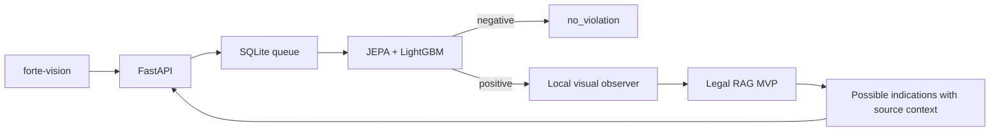

# Forte Vision

Локальный AI-сервис для проверки видеозаписей кассовых операций. **Datathon 26 · кейс ForteBank.**

[Открыть сервис](https://forte26.vercel.app/app) · [API](https://154.54.100.194.sslip.io/docs) · [Handoff разработчику](docs/HANDOFF.md) · [Аудит](docs/AUDIT.md)

> **Статус передачи 18.10.2026:** активен режим `possible_indications`: JEPA выбирает риск, Qwen описывает видимые действия, RAG даёт объяснение и источник для проверки человеком. Неизвестные правовые условия остаются в результате. Источники выбираются также за пределами карточек; интерфейс показывает полный пункт и связанные положения. Это не окончательное юридическое заключение; ссылка уровня документа может быть только контекстом. Проверки и ограничения — в [описании MVP](docs/RAG_MVP_POLICY.md). Предыдущие handoff/audit описывают старое состояние.

## Что внутри

Подробная схема моделей, нормативного поиска, генерации и проверок — [README по Legal RAG и Qwen](docs/LEGAL_RAG_QWEN_README.md).

Обновление 18.10.2026: на GPU развёрнута [v3.2 — исправления Qwen без замены моделей](docs/QWEN_PROMPTS_V3_2_2026-10-18.md), build `224cff2bf11c056d`. Камера ограничена наблюдаемыми фактами; объяснение сфокусировано на выбранном требовании, ссылки проверяются по реальному нормативному пакету. Сохранены полные цитаты, источник в description и контракт API из [v3.1](docs/SOURCE_CONTRACTS_V3_1_2026-10-18.md). Экспериментальный второй фильтр риска не включён.

| Компонент | Стек и назначение |
|---|---|
| Интерфейс | React 19, Vinext, TypeScript, Tailwind; RU / KK / EN |
| API | FastAPI, асинхронные задания, авторизация по X-API-Key |
| Очередь | SQLite WAL, отдельный resident GPU worker |
| Детектор | JEPA-LGBM-FULL: frozen JEPA + две головы LightGBM без PCA, примерный таймкод |
| Наблюдения | Локальный Qwen3-VL-8B: видимые факты и ссылки на кадры |
| Нормативная проверка | Legal RAG с версионированным MVP-патчем: BGE-M3 + BM25, Qwen3-VL-4B |
| Развёртывание | NVIDIA Brev A100 80 GB, systemd, Docker, Caddy HTTPS |
| Короткий адрес | Vercel rewrite; видео загружается напрямую на GPU-сервер |



Модели исполняются внутри сервиса. Worker работает с отключённой сетью; после загрузки весов обработка не требует доступа к интернету. Аудио и идентификация лиц не используются. Результат предназначен для проверки человеком.

## Использование

1. Открыть [рабочее пространство](https://forte26.vercel.app/app).
2. Выбрать MOV и нажать «Начать проверку». Сервер подключается автоматически.
3. Дождаться обработки и проверить таймкоды, кадры, объяснение и нормативный источник.

Ручного ввода адреса и ключа на фронте нет. Браузер получает временную сессию с доступом только к собственным заданиям; ключ жюри остаётся на сервере. Демонстрационные записи явно отмечены.

**Текущие лимиты:** файл до 10 ГиБ, видео до 180 секунд, разрешение до 4096×2160. Загрузка большого файла на практике ещё требует проверки. Задания сохраняются в очереди без прежнего ограничения в два запроса. Одна GPU не гарантирует соблюдение SLA при перегрузке: API жюри имеет дедлайн 285 секунд от приёма, браузерные задания — от начала обработки.

## API жюри

Ключ передаётся в заголовке `X-API-Key`. Получить его у владельца проекта; в репозитории ключей нет.

```bash
export FORTE_API_URL="https://154.54.100.194.sslip.io"
# FORTE_API_KEY задаётся в окружении отдельно.
curl -X POST "$FORTE_API_URL/api/v1/analyze" \
  -H "X-API-Key: $FORTE_API_KEY" -F "file=@video.mov"
curl "$FORTE_API_URL/api/v1/jobs/<job_id>" \
  -H "X-API-Key: $FORTE_API_KEY"
```

POST возвращает `202` и `job_id`. GET возвращает `processing`, `done` или `failed`. Успешный результат:

```json
{
  "job_id": "example",
  "status": "done",
  "verdict": "no_violation",
  "violations": []
}
```

При `violation` каждое событие содержит `type`, `timecode_sec`, `description`, 1–3 JPEG в `evidence_frames`, а также нормативный источник в `rule`. Ошибка анализа не подменяется чистым вердиктом. `/healthz` проверяет HTTP, `/readyz` — готовность моделей; это не подтверждение разрешения публикации RAG.

## Продолжить разработку

**Начать с [docs/HANDOFF.md](docs/HANDOFF.md).** Там описаны доступ к VM, активные сервисы, расположение моделей, команды деплоя, исходное состояние. Актуальные изменения pipeline и политика описаны в [RAG MVP](docs/RAG_MVP_POLICY.md).

```text
backend/                         API, очередь, worker, адаптеры
forte-vision/                    пользовательский интерфейс
model_packages/jepa_lgbm/         активный неизменённый пакет JEPA-LGBM-FULL
model_packages/jepa_lgbm/weights/ локальные веса, исключены из Git
JEPA-FULL/                       архив прежнего SVM-пакета; рабочий pipeline его не импортирует
ForteBank-Legal-RAG-2026-10-18/   исходный нормативный RAG
config/                          конфигурация внешнего observer и список правил
deploy/                          systemd, Caddy, frontend build, Vercel rewrite
scripts/                         установка, диагностика, проверки и упаковка
tests/                           backend-контракты и проверки интеграции
docs/                            handoff и аудит
```

Веса, исходные ZIP, видеодатасет, ключи и журналы не входят в Git. Для запуска нужны исходные артефакты от владельца и веса закреплённых моделей. `scripts/bootstrap.sh` и systemd units рассчитаны на текущую Linux VM; перед переносом проверить пути. Dockerfile фронта сейчас использует существующий production image и требует доработки для чистой сборки с нуля.

Активный детектор выбирается через `config/detector.json`, загрузка через `backend/detector.py` и публичный `JepaModel.predict()`. Исходники нового пакета сохранены побайтно; SHA-256 проверяются перед загрузкой весов. Qwen и Legal RAG продолжают получать тот же контракт. Детали, установка весов и откат — [JEPA + LightGBM](docs/JEPA_LGBM_DEPLOYMENT.md).

Для чистого клона установить зависимости из `requirements.txt`, затем добавить веса из переданного владельцем ZIP:

```bash
.venv/bin/python scripts/install_detector.py --archive /path/to/JEPA-LGBM-FULL.zip
.venv/bin/python scripts/install_detector.py
```

ZIP и веса не добавляются в Git. `scripts/bootstrap.sh` также принимает путь через `JEPA_ARCHIVE`. Историческая проверка первоначальных JEPA-SVM/RAG ZIP — `scripts/verify_inputs.py`; она не выбирает активный детектор.

## Проверки и открытые задачи

| Проверка | Последний результат |
|---|---|
| Backend с JEPA-LGBM на VM | 39 passed |
| Frontend typecheck | Пройден |
| Frontend unit | 108 passed в structural-sources-v3; при замене детектора UI не менялся |
| Chromium / WebKit E2E | 74 passed в structural-sources-v3; при замене детектора UI не менялся |
| Реальный API с JEPA-LGBM | Х-18: 3 события за 74.075 с; Х-45: no_violation за 10.467 с серверной обработки |

Текущие проверки источников и полного API — [structural-sources-v3](docs/STRUCTURAL_SOURCES_V3_2026-10-18.md). FULL-детектор обучен на всех 40 видео: smoke на них проверяет работоспособность, а не независимый F1. Для оценки качества нужны новые размеченные видео.
