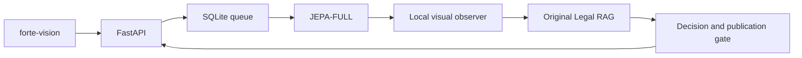

# Forte Vision

Локальный AI-сервис для проверки видеозаписей кассовых операций. **Datathon 26 · кейс ForteBank.**

[Открыть сервис](https://forte26.vercel.app/app) · [API](https://154.54.100.194.sslip.io/docs) · [Handoff разработчику](docs/HANDOFF.md) · [Аудит](docs/AUDIT.md)

> **Статус: интеграция развёрнута, подготовка к сдаче не завершена.** Исходный RAG блокирует публикацию всех восьми черновых карточек. Положительная выдача и обработка всех видео за 5 минут пока не подтверждены. Актуальное состояние и незавершённые изменения — в [handoff](docs/HANDOFF.md).

## Что внутри

| Компонент | Стек и назначение |
|---|---|
| Интерфейс | React 19, Vinext, TypeScript, Tailwind; RU / KK / EN |
| API | FastAPI, асинхронные задания, авторизация по X-API-Key |
| Очередь | SQLite WAL, отдельный resident GPU worker |
| Детектор | Исходный JEPA-FULL: бинарный сигнал и временная локализация |
| Наблюдения | Локальный Qwen3-VL-8B: видимые факты и ссылки на кадры |
| Нормативная проверка | Исходный Legal RAG: BGE-M3 + BM25, Qwen3-VL-4B |
| Развёртывание | NVIDIA Brev A100 80 GB, systemd, Docker, Caddy HTTPS |
| Короткий адрес | Vercel rewrite; видео загружается напрямую на GPU-сервер |



Модели исполняются внутри сервиса. Worker работает с отключённой сетью; после загрузки весов обработка не требует доступа к интернету. Аудио и идентификация лиц не используются. Результат предназначен для проверки человеком.

## Использование

1. Открыть [рабочее пространство](https://forte26.vercel.app/app).
2. Выбрать MOV и нажать «Начать проверку». Сервер подключается автоматически.
3. Дождаться обработки и проверить таймкоды, кадры, объяснение и нормативный источник.

Ручного ввода адреса и ключа на фронте нет. Браузер получает временную сессию с доступом только к собственным заданиям; ключ жюри остаётся на сервере. Демонстрационные записи явно отмечены.

**Текущие лимиты:** файл до 10 ГиБ, видео до 180 секунд, разрешение до 4096×2160. Загрузка большого файла на практике ещё требует проверки. Задания сохраняются в очереди без прежнего ограничения в два запроса. Одна GPU не гарантирует соблюдение SLA при перегрузке: API жюри имеет дедлайн 285 секунд от приёма, браузерные задания — от начала обработки.

## API жюри

Ключ передаётся в заголовке `X-API-Key`. Получить его у владельца проекта; в репозитории ключей нет.

```bash
export FORTE_API_URL="https://154.54.100.194.sslip.io"
# FORTE_API_KEY задаётся в окружении отдельно.
curl -X POST "$FORTE_API_URL/api/v1/analyze" \
  -H "X-API-Key: $FORTE_API_KEY" -F "file=@video.mov"
curl "$FORTE_API_URL/api/v1/jobs/<job_id>" \
  -H "X-API-Key: $FORTE_API_KEY"
```

POST возвращает `202` и `job_id`. GET возвращает `processing`, `done` или `failed`. Успешный результат:

```json
{
  "job_id": "example",
  "status": "done",
  "verdict": "no_violation",
  "violations": []
}
```

При `violation` каждое событие содержит `type`, `timecode_sec`, `description`, 1–3 JPEG в `evidence_frames`, а также нормативный источник в `rule`. Ошибка анализа не подменяется чистым вердиктом. `/healthz` проверяет HTTP, `/readyz` — готовность моделей; это не подтверждение разрешения публикации RAG.

## Продолжить разработку

**Начать с [docs/HANDOFF.md](docs/HANDOFF.md).** Там описаны доступ к VM, активные сервисы, расположение моделей, команды деплоя, результаты проверок и локальная правка pipeline, ещё не выложенная на сервер.

```text
backend/                         API, очередь, worker, адаптеры
forte-vision/                    пользовательский интерфейс
JEPA-FULL/                       исходный пакет, без весов в Git
ForteBank-Legal-RAG-2026-10-18/   исходный нормативный RAG
config/                          конфигурация внешнего observer и список правил
deploy/                          systemd, Caddy, frontend build, Vercel rewrite
scripts/                         установка, диагностика, проверки и упаковка
tests/                           backend-контракты и проверки интеграции
docs/                            handoff и аудит
```

Веса, исходные ZIP, видеодатасет, ключи и журналы не входят в Git. Для запуска нужны исходные артефакты от владельца и веса закреплённых моделей. `scripts/bootstrap.sh` и systemd units рассчитаны на текущую Linux VM; перед переносом проверить пути. Dockerfile фронта сейчас использует существующий production image и требует доработки для чистой сборки с нуля.

**JEPA и RAG не изменять без согласования с владельцем.** Их исходные файлы сохранены отдельно от интеграции; контроль целостности по предоставленным ZIP — `python scripts/verify_inputs.py`.

## Проверки и открытые задачи

| Проверка | Последний результат |
|---|---|
| Backend на VM | 20 passed |
| Frontend typecheck | Пройден |
| Frontend unit | 103 passed / 3 failed |
| Chromium / WebKit E2E | 74 passed до изменения auto-connect; повторный запуск требуется |
| Реальный положительный API-сценарий | Не подтверждён: публикационный gate и тайм-ауты |

Приоритет: согласовать статус карточек RAG, исправить оставшиеся frontend-тесты, проверить автоматическую загрузку и восстановление задания, затем измерить реальные положительные видео и очередь в пределах SLA. Подробности и ограничения тестовых результатов — в handoff.
