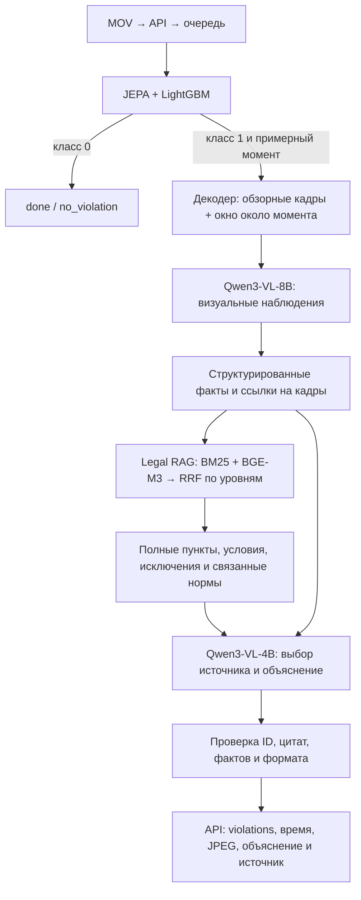

# Legal RAG и Qwen — README для команды

Состояние на 18 октября 2026 года. Этот документ описывает рабочую связку и отдельно отмечает изменения, которые ещё проходят проверку.

**На сервере работает JEPA-LGBM-FULL + визуальная Qwen3-VL-8B + Legal RAG с текстовой Qwen3-VL-4B, обновление v3.2 (build `224cff2bf11c056d`).** Веса и модели не менялись, Qwen не дообучалась. Qdrant и нейронный reranker не используются. Экспериментальный второй фильтр v4 отклонён.

## 1. Общая схема



JEPA возвращает бинарный результат и приблизительный таймкод; кадры извлекает отдельный видеодекодер. Сама JEPA не выбирает закон и не пишет объяснение. При отрицательном классе дорогие вызовы Qwen и RAG пропускаются. Поэтому пропуск классификатора нельзя исправить последующим RAG.

## 2. Две разные роли Qwen

| Компонент | Вход | Задача | Выход |
|---|---|---|---|
| **Qwen3-VL-8B-Instruct**, визуальный адаптер | Исходные кадры с PTS, словарь наблюдаемых действий | Описать видимое действие, момент, роль и свидетельства | Факты со статусами и ссылками на кадры |
| **BGE-M3**, поисковый encoder | Текст фактов или структурного фрагмента нормы | Получить векторы для смыслового поиска | Dense embeddings |
| **Qwen3-VL-4B-Instruct**, внутри Legal RAG | Структурированные факты и ограниченный нормативный пакет | Привязать наблюдение к найденному требованию и объяснить связь | Проверяемые ID источников и короткое условное объяснение |

Визуальная 8B находится **перед** нормативным RAG. Текстовая 4B работает **внутри** RAG; несмотря на VL в названии, на этом этапе изображения ей не передаются. Эмбеддинги делает BGE-M3, а не Qwen.

Визуальный проход использует до 12 обзорных кадров для коротких видео, до 24 для более длинных и до 7 кадров около момента классификатора. Это разреженное наблюдение: оно не доказывает отсутствие действия между кадрами.

## 3. Что получает RAG

Контракт входа — `legal_rag.input.v1`. Он содержит:

- контекст организации и дату события, если она известна;
- участников с функциональной ролью и статусом её установления;
- факты: `fact_id`, `predicate`, `status`, `statement`;
- связь факта с участником, операцией, временным интервалом и кадрами.

Статусы факта: `confirmed`, `refuted`, `unknown`. Отсутствующий предикат означает неизвестность. `refuted` требует наблюдаемого свидетельства, а не просто отсутствия объекта на одном кадре. Противоречивые факты сохраняются как конфликт.

RAG не получает видео, изображения, score или label JEPA. Входной контракт запрещает поля классификатора: они не должны превращаться в доказательство применения нормы.

С v3.2 камера не подтверждает принадлежность/юридическую разрешённость предмета, предысторию наличных и полноту непрерывного наблюдения: соответствующие шесть предикатов исключены из её вариантов ответа. При обходном ответе они остаются unknown. Явная роль client не подтверждает уход сотрудника с рабочего места.

Пример смысла входа: «работник покинул рабочее место» подтверждено кадрами; «обслуживание завершено» неизвестно. Поиск может найти норму об уходе до окончания обслуживания, но неизвестное условие не становится подтверждённым.

## 4. Источники и структурный чанкинг

Корпус содержит **54 нормативных снимка РК**, включая пять основных актов НБРК. Сохраняются URL, исходный текст, хэши и положение фрагмента в документе. Наличие документа в библиотеке не означает автоматическую применимость к конкретной операции.

Индекс построен по структуре документов: **5 640 единиц и 10 046 поисковых дочерних фрагментов**.

- Контейнеры разделяют постановление, утверждённые правила, приложения и другие вложенные документы. Номер пункта уникален только внутри своего контейнера.
- Родитель — полный пункт или статья. Короткий родитель индексируется целиком.
- Длинный родитель делится по подпунктам. Поисковый child сохраняет заголовки и вводную часть, чтобы его смысл не терялся.
- После совпадения восстанавливается полный родитель. Повторные попадания в один родитель объединяются.
- Сноски, приостановления, отменённые положения и аномалии нумерации учитываются отдельно.
- Если структуру нельзя надёжно разобрать, остаются точные диапазоны строк и ссылка уровня документа.

Это parent–child, а не простая нарезка каждого документа через одинаковое количество символов. В выдачу попадает выбранный пункт и связанный контекст; весь акт или все 54 документа в Qwen не загружаются.

## 5. Гибридный поиск

1. Из структурированных фактов строится запрос. Отрицания сохраняются; неизвестные условия не используются как установленные действия.
2. BM25 ищет точные термины. Предикатный/контекстный словарь помогает сопоставлять бытовую и нормативную лексику.
3. BGE-M3 ищет смысловую близость на тех же структурных единицах.
4. Результаты объединяются **RRF по рангам внутри одного уровня**.
5. `core` рассматривается первым, `operational` — отдельно. Их сырые BM25 scores и cosine similarity не смешиваются.

Текущие настройки: до 50 кандидатов от каждого поисковика, `rrf_k=60`, `top_k=5`. Высокий поисковый score сам по себе не является подтверждением релевантности или нарушения.

Векторы рассчитываются заранее и хранятся в локальном индексе с manifest. Для примерно 10 тысяч фрагментов отдельная векторная БД не нужна. **Qdrant сейчас отсутствует; reranker отключён (`null`).**

## 6. Нормативный пакет, применение и генерация

Система проверяет восемь карточек правил. Если карточка не подошла, рабочий MVP умеет выбирать структурный источник за пределами карточек. В пакет входят основной полный пункт и доступные связанные положения: условия, исключения, определения и перекрёстные ссылки.

Размер контекста ограничен. Альтернативные родители могут пропускаться целиком с записью причины; основной пункт нельзя молча обрезать до обрывка. Неразрешённая внешняя ссылка или неизвестная применимость сохраняются в результате как ограничение.

Qwen4B выбирает допустимые ID нормы, фрагмента требования и подтверждающих фактов. Точную цитату, URL и название документа код берёт из корпуса. Затем модель формулирует короткую связь между наблюдением и источником. В v3.2 точная выбранная строка отдельно выделена как фокус, а полный нормативный пакет сохранён. Числовая ссылка принимается только при привязке к выбранному источнику и реально включённым связанным пунктам того же контейнера. Это не проверяет истинность свободного текста или каждого визуального факта. При невалидном объяснении используется учтённый `template_fallback`; это не считается успешной нейронной генерацией.

Есть два разных режима:

- `LegalRAGRuntime.analyze()` — формальное применение нормы. Для `violation_supported` нужны установленные обязательные условия и исключения. Черновые карточки сохраняют свои ограничения публикации.
- `LegalRAGRuntime.review()` — активный маршрут сервиса, `possible_indications`: признаки для проверки человеком с явными неизвестными условиями. Это не окончательное заключение о правонарушении.

Восемь исходных карточек остаются черновыми: подписи проверяющих не выдумывались, `human_reviewed` и `production_active` не переключались. Отдельный review-режим не меняет результаты формального режима.

У источника различаются `candidate_clause` — кандидатный пункт для проверки, и `context_only` — общий нормативный контекст без установленного нарушенного пункта. Контекстная ссылка не доказывает нарушение.

## 7. Что получает API и интерфейс

API жюри: `POST /api/v1/analyze`, multipart `file`, заголовок `X-API-Key` → `202` и `job_id`. Опрос: `GET /api/v1/jobs/{job_id}`. Статусы: `processing`, `done`, `failed`.

Успешный ответ содержит `verdict=violation/no_violation` и массив **`violations`**. В событии:

- `type`, `timecode_sec`, `description`;
- `evidence_frames`: 1–3 исходных JPEG/base64 с PTS;
- `rule`: название, URL, точный пункт при наличии, полная цитата выбранного пункта и связанный контекст;
- дополнительные поля о неизвестных условиях и характере связи с источником.

Передаётся полный выбранный пункт, а не вся законодательная база. Ошибка обработки не заменяется отрицательным вердиктом. Несколько событий разрешены контрактом. В v3.1 жёсткий лимит в три эпизода снят: два текущих визуальных прохода дают максимум четыре кандидата, повторные наблюдения объединяются до RAG. Отдельного «главного» события нет.

## 8. GPU, контекст и скорость

| GPU | CPU |
|---|---|
| JEPA encoder | LightGBM и подготовка признаков |
| Обе Qwen, BF16 | Декодирование/подготовка видео в текущей реализации |
| BGE-M3 encoder и dense-поиск | Разбор документов, BM25, RRF |
| | Сборка пакета, контракты, проверки ссылок и JSON, API/очередь |

Модели загружаются один раз в resident worker. Очередь GPU одна. После подготовки весов обработка локальная; production worker запускается с `PrivateNetwork=true` и offline-настройками HF/Transformers.

Бюджеты приложения: визуальная Qwen — **24 576 входных / до 1 800 выходных токенов**; текстовая — **8 192 / до 900**. Отдельные короткие вызовы могут иметь меньший выходной лимит. Это настройки сервиса, а не максимальная длина контекста архитектуры. Обе Qwen сейчас BF16, **8B означает число параметров, не 8-битную квантизацию**.

Для ориентира, только веса 8B BF16 — около 16 GB, 4B — около 8 GB; KV-cache, изображения, временные тензоры, JEPA и BGE требуют дополнительную память. Нельзя считать сумму весов требуемой VRAM всего сервиса. Целевая VM — A100 80 GB.

Поиск обычно существенно дешевле визуального и текстового inference. В финальном API smoke v3.2 отрицательные видео обрабатывались за 9,837–13,628 с, положительные — за 27,242–93,391 с. Это шесть обучающих примеров, не p95 и не гарантия пяти минут для любого видео или очереди.

## 9. Где лежит реализация

```text
backend/pipeline.py                   связка детектора, кадров, observer и RAG
backend/vision.py                     визуальная Qwen8B
backend/legal.py                      преобразование RAG-результата для API
backend/detector.py                    загрузка JEPA-LGBM с проверкой хэшей
config/detector.json                   активный детектор
config/observer.json                   визуальная Qwen
config/rag-mvp.json                    BGE, Qwen4B, retrieval и бюджеты
config/analysis-policy.json            possible_indications
ForteBank-Legal-RAG-2026-10-18/          исходный переданный пакет
patches/legal-rag-mvp-v1/legal_rag/     исходники изменений RAG
releases/legal-rag-mvp-v1/legal_rag/    собранная рабочая версия RAG
data/legal_index_stock/                локальный индекс и manifest
models/ и HF cache                    локальные веса, вне Git
```

Не редактировать только сгенерированный `releases/`: изменения должны сохраняться в `patches/`. `scripts/install_rag_mvp.py` предназначен для сборки release и защищён от несовпадения существующей сборки; его нельзя считать командой безусловного обновления production.

Для переноса нужны код, зависимости `requirements.txt`, исходный нормативный пакет, веса закреплённых revisions, индекс либо его пересборка, конфигурация и переменные окружения. Чистый Git-клон не содержит тяжёлых весов, приватных видео или ключей.

## 10. Как проверять

Структурные тесты RAG из собранного release на Linux:

```bash
cd /home/shadeform/forte-service/releases/legal-rag-mvp-v1
../../.venv/bin/python -m unittest discover -s legal_rag/tests -t .
```

Backend-тесты из корня сервиса:

```bash
.venv/bin/python -m pytest tests -q
```

Unit-тесты проверяют контракты, источники, поиск, ограничения и fake/template backends. Они не измеряют способность реальной Qwen видеть действие. Для этого нужен отдельный прогон на видео с сохранением версий, таймингов, результатов каждого этапа и ручной проверкой фактов/источников.

Тестировать следует отдельно: классификатор; наблюдения Qwen8B; retrieval на фиксированных фактах; применение нормы; генерацию; весь API. Повторный прогон на обучающих 40 видео — smoke-проверка, не независимая метрика качества.

## 11. Обновление API и источников, эксперимент v4

В развёрнутом обновлении v3.1 добавлены типизированные ответы API, цитирование источника в обязательном `description`, объединение повторных эпизодов до RAG, функциональные роли, проверки области применения норм и исправления constrained JSON, кириллицы и EOS. Эта версия сохраняет схему отбора наблюдений после JEPA.

**58 backend и 144 RAG теста v3.2 проходят.** Полный staging smoke и шесть реальных API-загрузок завершились успешно; все 11 внутренних нормативных ответов получили валидную конечную генерацию без шаблонной замены. На отрицательных Qwen/RAG не запускались. Прежний второй фильтр v4 и полная перепись визуального промпта не включены: преимущество не подтверждено. Эти числа не являются precision/recall модели. Актуальные результаты — [Qwen v3.2](QWEN_PROMPTS_V3_2_2026-10-18.md); предыдущее API-обновление — [v3.1](SOURCE_CONTRACTS_V3_1_2026-10-18.md).

Основные оставшиеся риски: ложные отрицательные JEPA, ошибки визуальных фактов, короткие действия между кадрами, неправильное применение найденной нормы, неизвестные условия и время ответа при нагрузке. Дополнительные документы или reranker сами по себе не исправляют ошибки восприятия.

Подробнее: [политика MVP](RAG_MVP_POLICY.md), [структурные источники v3](STRUCTURAL_SOURCES_V3_2026-10-18.md), [JEPA-LGBM](JEPA_LGBM_DEPLOYMENT.md), [проверяемые изменения v4](GROUNDED_EPISODES_V4_2026-10-18.md).
